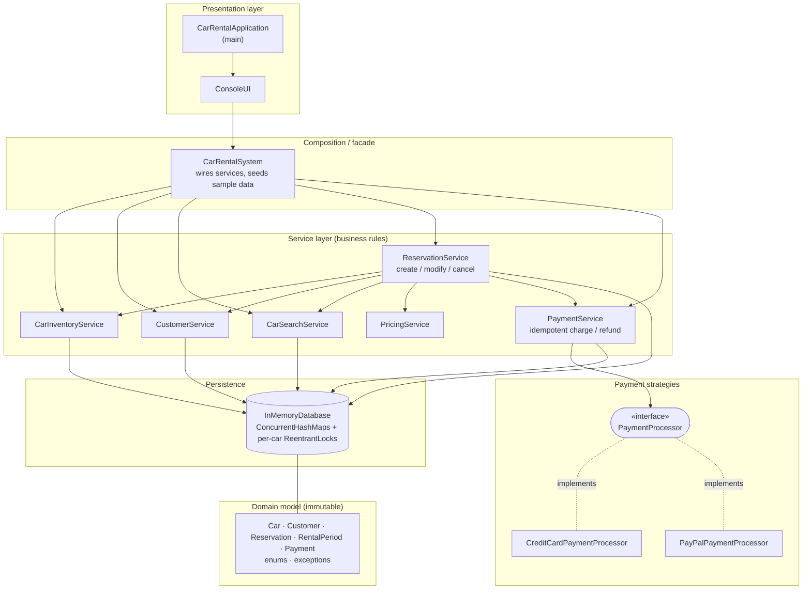
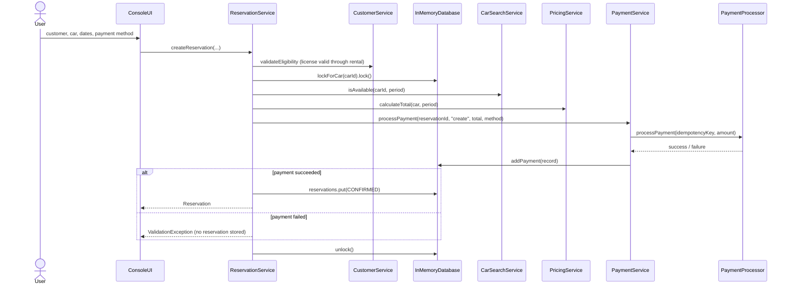

# Car Rental System

A Java 17+ console application for in-memory car inventory, date-based search, reservations, and simulated payments. The application has no runtime service or database dependencies. Maven supplies JUnit 5 for the test suite.

## Architecture

`CarRentalApplication` starts `ConsoleUI`; `CarRentalSystem` composes the services and seeds example data. The UI handles input/output, while validation and business rules live at service/domain boundaries. Immutable domain objects are stored in `InMemoryDatabase`.

### Block Diagram



The same layering as plain text:

```text
+--------------------------------------------------------------------------------+
|  PRESENTATION      CarRentalApplication  -->  ConsoleUI                        |
+--------------------------------------------------------------------------------+
                                      |
+--------------------------------------------------------------------------------+
|  FACADE            CarRentalSystem  (composes services, seeds sample data)     |
+--------------------------------------------------------------------------------+
                                      |
+--------------------------------------------------------------------------------+
|  SERVICES                                                                      |
|                        +----------------------+                                |
|                        |  ReservationService  |                                |
|                        +----------------------+                                |
|          uses:  |            |            |            |            |          |
|   +-----------+ +-----------+ +-----------+ +-----------+ +----------------+   |
|   | CarInv.   | | Customer  | | CarSearch | | Pricing   | | PaymentService |   |
|   | Service   | | Service   | | Service   | | Service   | |                |   |
|   +-----------+ +-----------+ +-----------+ +-----------+ +----------------+   |
+--------|-------------|-------------|-----------------------------|-------------+
         |             |             |                             v
         |             |             |            +------------------------------+
         |             |             |            | PAYMENT STRATEGIES           |
         |             |             |            |  <<PaymentProcessor>>        |
         |             |             |            |   |- CreditCardPayment...    |
         |             |             |            |   '- PayPalPayment...        |
         |             |             |            +------------------------------+
         v             v             v                             |
+--------------------------------------------------------------------------------+
|  PERSISTENCE       InMemoryDatabase                                            |
|                    cars | customers | reservations | payments | per-car locks  |
+--------------------------------------------------------------------------------+
|  DOMAIN            Car, Customer, Reservation, RentalPeriod, Payment           |
|                    (immutable)  +  enums/  +  exception/                       |
+--------------------------------------------------------------------------------+
```

### Reservation Flow



`ReservationService` coordinates the other services and is the only one that combines availability, pricing, and payment. It runs these checks while holding the car's lock, so two bookings for the same car can't both succeed.

The payment strategy implementations are `CreditCardPaymentProcessor` and `PayPalPaymentProcessor`. They are injected into `PaymentService`; reservation logic depends on that service rather than a concrete processor.

## Packages

```text
com.carrental
  CarRentalApplication.java
  CarRentalSystem.java
  enums/          CarType, CarStatus, ReservationStatus, PaymentStatus, PaymentMethod
  exception/      ValidationException, NotFoundException
  model/          Car, Customer, Payment, RentalPeriod, Reservation
  payment/        PaymentProcessor, CreditCardPaymentProcessor, PayPalPaymentProcessor
  repository/     InMemoryDatabase
  service/        inventory, customer, search, pricing, payment, reservation services
  ui/             ConsoleUI
```

## Build And Run

Requirements: JDK 17 or newer and Maven 3.9 or newer.

```powershell
mvn clean test
mvn package
java -cp target/classes com.carrental.CarRentalApplication
```

The console starts with sample cars `C-100`, `C-200`, and `C-300` plus customer `U-100`. Dates use ISO format (`yyyy-mm-dd`); payment options are `CREDIT_CARD` and `PAYPAL`. No payment credentials are requested.

## Sample Output

With customer `U-100`, car `C-100`, pickup `2027-01-10`, return `2027-01-13`, and `CREDIT_CARD`:

```text
Reservation confirmed: Reservation 37f...: customer=U-100 car=C-100 [2027-01-10, 2027-01-13) total=144.00 status=CONFIRMED created=...
Payment 91a...: reservation=37f... amount=144.00 method=CREDIT_CARD status=SUCCESS at=...
```

If another customer requests `C-100` for `2027-01-12` through `2027-01-15`:

```text
Operation failed: Car is already reserved for part of the requested period.
```

The return date is exclusive. A reservation ending on January 13 does not conflict with one starting January 13.

## Concurrency And Consistency

Maps are backed by `ConcurrentHashMap`; payment histories use copy-on-write lists. Booking, modification, cancellation, car status updates, and removal synchronize on a per-car `ReentrantLock`. The availability check and reservation state update happen while holding that same lock. Calls affecting separate cars can proceed independently; a single global booking lock is not used. Cancellation and modification acquire only the reservation's car lock, so they coordinate with competing bookings without lock-order cycles.

The payment processors are deterministic, local simulations and do not perform network I/O. Payment processing happens within the per-car transaction so that the interval cannot be claimed while payment is unresolved; this blocks only operations on that same car. Replacing a processor with a slow external gateway would require a pending-reservation/expiry or compensation workflow rather than holding this lock across a remote call. Payment operation keys prevent repeated calls for the same reservation operation from recording duplicate charges.

## Assumptions And Limitations

- Pickup is inclusive and return is exclusive; rentals require pickup before return and cannot start in the past.
- A driver's license must remain valid through the last rental day (`returnDate - 1 day`).
- A charge succeeds for a positive amount up to and including 10,000.00; higher amounts fail. Simulated refunds for positive charges succeed. Both processors use this documented deterministic rule.
- Only `CONFIRMED` reservations block availability. Cancelled and completed records are retained and do not block it.
- Data is held in memory and is lost when the process exits. This is a learning/demo design, not durable storage or a production payment solution.
- The service layer supports car detail updates and removals, though the menu focuses on registration, browsing, reservations, payment records, and operational status.
- Refund policy is a full simulated refund on cancellation and when replacing the payment for a modified reservation.